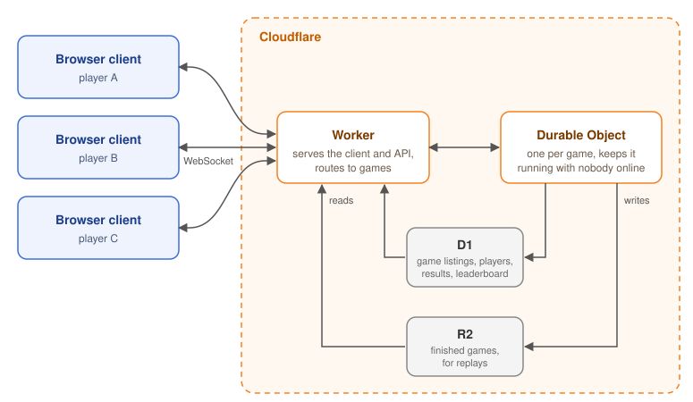

[Tessera](https://tessera.qot.nz) was meant to be a fully peer-to-peer strategy game, but it stalled as a complicated mess of WebRTC applications. What unblocked it was revisiting the requirements after building my daughter's trick-or-treat game. Here's how a Halloween game made the big one simpler.

<!--more-->

## The stalled project

I have fond memories of playing the territory-building web game [Empire Attack](https://www.ianandrew.com/empire-attack), spending hours a night with friends maintaining an empire as a team. _Farming coins_ in order to trigger a large cascade, resulting in massive jumps in claimed area.  A strange calm, from the _mundane_ task of clicking a square every few minutes when the population counter reaches 999.  There was a real sense of loss when I learned the game had shut down; a longing to be able to play it once again.

When I set out to replicate Empire Attack, I wanted it to be fully p2p, with no central game server.  My main reason was to keep it free and always available, so it couldn't disappear the way Empire Attack did: a static webpage on GitHub Pages, using PeerJS to connect players, and determining a game state through a consensus mechanism.  

A couple of years ago, I started with a [prototype](https://tessera.qot.nz/prototype/): the basic mechanics of placing tiles for attacking and defending, and a simple bot as an opponent.  

    <figure>
        
        <figcaption>Prototyping my replication of Empire Attack.</figcaption>
    </figure>

I then used this prototype as the starting point for Claude to turn it into a multiplayer game using WebRTC, to add more game mechanics such as coin cascades and placing bridges to cross rivers.  
Claude helped implement a deterministic game state, where each player validates every move and the game advances by consensus.

Complexity started creeping in when I wanted non-browser player clients:  
- Bots that were connected through the p2p mesh, possibly controlled by an LLM.  
- _Observer_ peers that could record the game and provide statistics.  
- _Hosts_ that could help keep a game alive when all players have disappeared.  

Along with browser players, all of these would contribute to validating moves and computing a game's state to avoid a case where any one player can control the game.

But it became a confusing web of infrastructure, a pile of abandoned local branches, and dread at returning to the codebase.

    <figure>
        
        <figcaption>The peer-to-peer version: six peers, fifteen connections, and the services needed to make them.</figcaption>
    </figure>

So I moved on to other projects, including a couple of games for my daughter.

## Juice Factory

On a Saturday, I had just finished retiring a VPS that I was hardly using. It was only being used for the Telegram bot that relays Guestbook entries for approval, which was easy to self-host instead, with the submission endpoint exposed through a Cloudflare tunnel.

Wanting to show what AI can do, I asked Elliott for a game she'd like me to make.  
Her answer: **Juice Factory**.  

I figured that sounded like [Cookie Clicker](https://orteil.dashnet.org/cookieclicker/), an incremental/idle game about baking cookies.  A perfect and easily achievable game for Claude to slop out as an example of what can be generated.

Since I already had the Cloudflare dashboard open, it was the easiest place to deploy Claude's single HTML file artefact for [Juice Factory](https://juice-factory.qot.nz).

    <figure>
        
        <figcaption>Juice Factory: squeeze the oranges, sell juice and buy upgrades.</figcaption>
    </figure>

## Trick or Treat: Elliott's spec

Juice Factory must have excited her, because she wrote the details for another game to build, this time with a bit more ambition.  

> Trick or treat!  
> There are costumes to wear, doors to knock on, and candy to collect!  
> The goal of the game is to collect as much as you possibly can.  
> There are 9 hats, 19 doors and 6 basket types. Each door has a spooky theme.  
> 10 hairstyles (5 boyish, 5 girlish)  
> 2 robes, 7 shirts, 7 pants  

I wanted something multiplayer, but still child-friendly, and to take advantage of what Cloudflare has to offer.

I took Elliott's handwritten spec, and instructed Claude to give me three options for possible games.

- Candy Street: Up to 6 friends dress up, then walk one street together on a timed Halloween night.
- Haunted Houses: Each of the 19 doors opens into a small spooky room. Find hidden candy, and decorate your own house for friends to visit.
- Candy Rush: 3–5 minute rounds where friends race around a small town grabbing candy. Most candy wins.

I settled on Candy Street, but renamed it to [Trick or Treat](https://halloween.qot.nz). In replacing the wording, I made it a more Kiwi game: with the option to collect lollies in a gumboot while wearing stubbies, a bucket hat and a rugby jersey.

It’s a multiplayer co-op game, with each street’s state held in a Durable Object, and it fits comfortably within Cloudflare’s free tier.

    <figure>
        
        <figcaption>Elliott’s handwritten spec: 9 hats, 19 doors, 6 basket types and a spooky theme for every door.</figcaption>
    </figure>
    <figure>
        
        <figcaption>Halloween night on the street: a witch-hatted trick-or-treater with 5:45 left on the clock.</figcaption>
    </figure>

## One codebase, three seasons

Something became obvious: a game designed around Halloween could be reskinned for Christmas and Easter.

- [Summer Santa](https://christmas.qot.nz): Play as Santa's helper, delivering toys to houses and receiving bikkies in exchange.
- [Egg Hunt](https://easter.qot.nz): Look for Easter eggs behind plants and garden gnomes.

The first step was to extract the Halloween-specific text and art as a theme. Then the Christmas and Easter themes could be created.  Mini-games were adapted to each theme, such as swapping _find the ghost_ for _find the bunny_.  Each game can be built and deployed independently to its own Worker and Durable Objects namespace.

Getting a multiplayer game running on Durable Objects, with no servers to babysit, gave me the confidence to take another look at Tessera.

    <figure>
        
        <figcaption>Out on the street: Ghost manor, between the Witch’s hut and the Mummy tomb.</figcaption>
    </figure>
    <figure>
        
        <figcaption>Up in the snowy north: the sleigh on the Log cabin roof, between the Mountain hut and the Village church.</figcaption>
    </figure>
    <figure>
        
        <figcaption>In the garden: the bird bath, between the gnome and the autumn leaves.</figcaption>
    </figure>

## Back to Tessera

I started with a new perspective and a revised set of requirements.  I opted for more simplicity, instead of a fully decentralised p2p game.  I wanted something playable, not a mess of applications.

Tessera moved from a trustless WebRTC mesh to one Cloudflare Worker with a Durable Object per game, so a game can be built, deployed, and played.  The Worker became responsible for serving the web client, replacing the GitHub Pages workflow.  A Durable Object per game lets a game keep running after everyone closes their browser.  Games run for 10 days, and you can close the tab and sleep; your empire idles until you’re back.

Some things stayed the same.  

Clients still validate moves and compute the game state through consensus.  The Durable Object validates too, acting as an independent referee, so a player who is alone online can’t run away with the game.  
A player’s identity is a keypair generated in their browser. It signs every move, which keeps the door open to a fully p2p version later.  

With the game hosted and working, I could focus on fixing and extending the gameplay, and on the UI.  
I made the view on mobile actually playable, and improved the layout on desktop. A new green colour scheme replaced the beige-heavy design.  
I also fixed coin spawning so _coin farming_ works: coins are more likely to spawn near an empire’s tiles, near other coins, or inside an area an empire has _fenced_ in.  

    <figure>
        
        <figcaption>Tessera's new green look: Vermilion (red) pushing into Verdant, eight days still on the clock.</figcaption>
    </figure>
    <figure>
        
        <figcaption>Tessera today: one Worker, one Durable Object per game, with D1 for listings and R2 for replays.</figcaption>
    </figure>

## Qot. games as a home

I set up a landing page at [qot.nz](https://qot.nz), branded as _Qot. games_: a home for Tessera, Juice Factory, the three seasonal games, and any new game I may make in the future.

I had one more idea, which came to me from an unlikely source: my Telegram LLM bot running [Qotbot](https://github.com/jason-s13r/qotbot), Molliott, had developed a strange behaviour in a particular chat. _She decided_ that a hallucinated EEPROM chip had the number 172 fused and write-locked as an immutable value. Any attempts to change this value would be rejected.  And so [Fuse 0xAC](https://fuse.qot.nz) was created, a _Papers, Please_-style game where you inspect incoming packets and spot the forgeries, with one rule that matters: nothing but 172 gets written to 0xAC.

    <figure>
        
        <figcaption>The Qot. games landing page at qot.nz.</figcaption>
    </figure>

## What's next

Small games that were quick to ship made the big one tractable. I stopped designing for every possible client, and built the one that people actually play.  

A fully p2p Tessera is still a goal, and the signed moves keep that path open.

Everything is free to play at [Qot. games](https://qot.nz).
